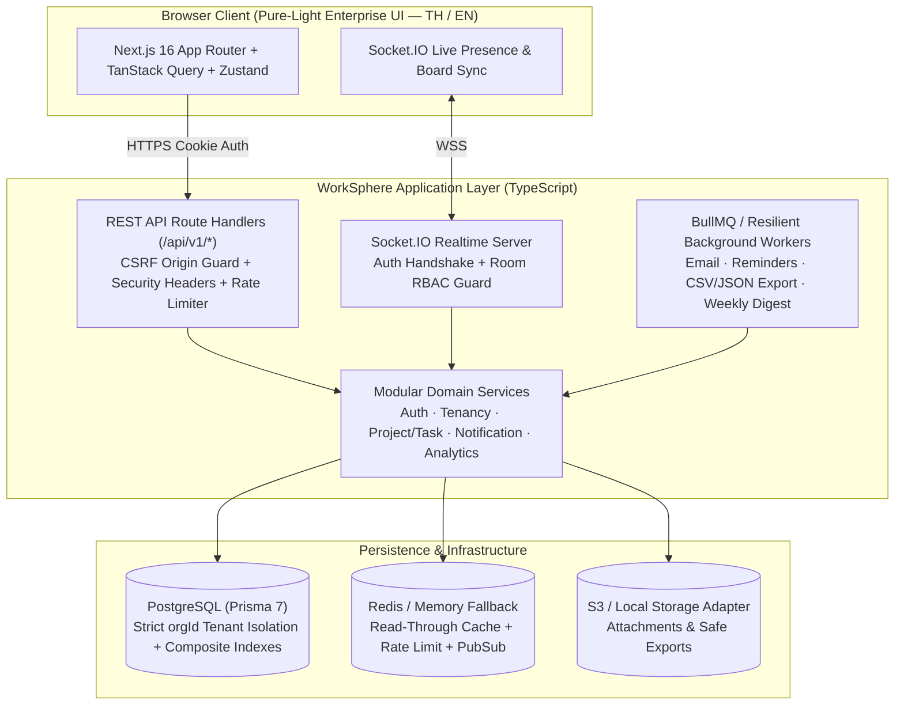

# WorkSphere — Multi-Tenant SaaS Project Management & Collaboration Platform

**WorkSphere** คือแพลตฟอร์มบริหารโปรเจกต์และทำงานร่วมกันระดับองค์กรสไตล์ **Jira + Trello** ที่พัฒนาขึ้นตั้งแต่ศูนย์ด้วย **Next.js 16 (TypeScript), PostgreSQL (Prisma 7), Redis, BullMQ และ Socket.IO** โดยออกแบบและเขียนระบบ Authentication, Session Rotation, 4-Tier RBAC, Multi-Tenant Isolation, Optimistic Locking และ DAG Dependency Engine ด้วยตัวเองทั้งหมดโดยไม่พึ่งพา Auth-as-a-Service

---

## สถาปัตยกรรมระบบ (System Architecture)



---

## จุดเด่นเชิงวิศวกรรม (Key Engineering Highlights)

| หมวดหมู่ | รายละเอียดการออกแบบ |
|---|---|
| **Custom Auth & Session Security** | แฮชรหัสผ่านด้วย **Argon2id**, แยกคุกกี้ `HttpOnly; SameSite=Lax` ระหว่าง `ws_access` (15 นาที, HMAC-SHA256) และ `ws_refresh` (30 วัน, เก็บเฉพาะ SHA-256 Hash) พร้อม **Session Family Reuse Detection** เพิกถอนยกชุดทันทีเมื่อตรวจพบการขโมยโทเคนไปใช้ซ้ำ |
| **Multi-Tenancy & 4-Tier RBAC** | กั้นขอบเขตข้อมูลระดับ `System` → `Organization` (`ORG_OWNER`, `ORG_ADMIN`, `MEMBER`) → `Workspace` (`WORKSPACE_ADMIN`, `MEMBER`) → `Project` (`PROJECT_MANAGER`, `MEMBER`, `VIEWER`) โดยการเข้าถึงข้ามองค์กรจะถูกตอบกลับเป็น `404 NOT_FOUND` เสมอเพื่อปิดช่องโหว่ Resource Enumeration |
| **Kanban & Workflow Engine** | ลากวางการ์ดอัปเดตเพียงแถวเดียว (`O(1)`) ด้วย **Base-36 Fractional Indexing**, ป้องกันการแก้ไขทับกันด้วย **Optimistic Locking (`version` → `409 VERSION_CONFLICT`)** และป้องกันวงจรปิดของงานที่ต้องรอกันด้วย **DFS Cycle Detection (`409 DEPENDENCY_CYCLE`)** |
| **Realtime Collaboration** | ซิงก์การสร้าง/แก้ไข/ย้ายการ์ด คอมเมนต์ `@mention` ศูนย์แจ้งเตือน และรายชื่อผู้ที่กำลังเปิดบอร์ดอยู่ (**Online Presence**) ผ่าน Socket.IO ที่บังคับตรวจสิทธิ์เข้าห้อง `project:{id}` ทุกครั้ง |
| **Caching, Workers & Analytics** | ระบบ Read-Through Cache พร้อมการล้างคีย์อัตโนมัติเมื่อเกิดการเปลี่ยนแปลง, คิวงานเบื้องหลัง Exponential Backoff Retry, ส่งออก CSV ที่ป้องกัน Formula Injection (`=,+,-,@`) และหน้า Dashboard / Project Analytics |
| **Verified Quality & Load** | ผ่านชุดทดสอบอัตโนมัติ **13 ไฟล์ / 43 ชุดทดสอบ** + Playwright E2E + ทดสอบโหลด **100 Concurrent Virtual Users** ได้ความเร็ว **`1,850.7 req/sec` (`p50 = 45.02 ms`, `0%` unexpected errors)** |

---

## เริ่มต้นรันโปรเจกต์ในเครื่อง (Quick Start)

### 1. ติดตั้งแพ็กเกจและตั้งค่า Environment
```bash
cd worksphere
cp .env.example .env
npm install
```
ตั้งค่า `DATABASE_URL` (PostgreSQL 16+ หรือ Neon Serverless Postgres) และ `AUTH_SECRET` (ความยาวอย่างน้อย 32 ตัวอักษร) ในไฟล์ `.env` *(หากไม่ได้ตั้ง `REDIS_URL` ระบบจะสลับไปใช้ In-Memory Cache, Rate Limiter และ Retry Queue อัตโนมัติสำหรับการพัฒนาในเครื่อง)*

### 2. สร้างตารางฐานข้อมูลและเติมข้อมูลตัวอย่าง (Safe Demo Seed)
```bash
npx prisma migrate deploy
npm run db:seed
```

### 3. เปิดเซิร์ฟเวอร์ใช้งาน
```bash
# เทอร์มินัลหลัก: เว็บแอปพลิเคชันและ REST API (http://localhost:3000)
npm run dev

# (ทางเลือก) เปิดโปรเซส Socket.IO Realtime Server คู่กันที่พอร์ต 3001
npm run dev:realtime

# (ทางเลือก) เปิดโปรเซส Background Queue Worker
npm run dev:workers
```

---

## บัญชีทดลองใช้งานสำหรับผู้ตรวจทาน (Demo Accounts)

หลังรันคำสั่ง `npm run db:seed` สามารถกดปุ่ม **Owner / Member / Viewer** บนหน้า `/login` เพื่อกรอกข้อมูลอัตโนมัติได้ในคลิกเดียว:

| บทบาทในองค์กร `worksphere-demo` | อีเมล | รหัสผ่าน | สิทธิ์การใช้งานที่ทดสอบได้ |
|---|---|---|---|
| **Org Owner & Project Manager** | `owner@demo.worksphere.io` | `DemoPass#2026` | จัดการองค์กร, สมาชิก, Audit Logs, คอลัมน์บอร์ด, ลบงานทุกใบ, Export CSV |
| **Member** | `member@demo.worksphere.io` | `DemoPass#2026` | สร้าง/แก้ไข/ลากการ์ด Kanban, ผูก Dependency, แนบไฟล์, คอมเมนต์ `@mention` |
| **Project Viewer** | `viewer@demo.worksphere.io` | `DemoPass#2026` | เปิดดูบอร์ด, รายการงาน, กราฟ Analytics และแสดงความคิดเห็น (บล็อกการแก้ไขงาน) |

---

## คำสั่งตรวจสอบคุณภาพโค้ดและชุดทดสอบ

```bash
npm run lint        # ESLint ตรวจมาตรฐานโค้ด
npm run typecheck   # Next.js Route Typegen + TypeScript strict check
npm test            # Vitest (Unit, Domain, HTTP Envelope & 4-Role Security Matrix)
npm run test:load   # ทดสอบโหลดพร้อมกัน 100 Concurrent Virtual Users
npm run test:e2e    # Playwright Browser End-to-End Tests
```

---

## สารบัญเอกสารวิศวกรรมครบชุด (`docs/`)

- [docs/README.md](docs/README.md) — สารบัญเอกสารทั้งหมดของโปรเจกต์
- [docs/requirements.md](docs/requirements.md) — ขอบเขตระบบ, ตารางสิทธิ์ 4 ระดับ และข้อกำหนด Functional / Non-functional (`WS-001`, `WS-002`)
- [docs/use-cases.md](docs/use-cases.md) — Use Case & Sequence Diagrams (`WS-003`)
- [docs/erd.md](docs/erd.md) — Entity-Relationship Diagram & Composite Indexing Strategy (`WS-004`)
- [docs/architecture.md](docs/architecture.md) — สถาปัตยกรรมโมดูล, Concurrency, Caching & Queue Design (`WS-005`)
- [docs/api-spec.md](docs/api-spec.md) — ข้อกำหนด REST API (`/api/v1/*`) & Socket.IO Realtime Events (`WS-006`)
- [docs/test-and-performance-report.md](docs/test-and-performance-report.md) — รายงานผลการทดสอบความปลอดภัยและผลวัดประสิทธิภาพ 100 VUs (`WS-701` – `WS-705`)
- [docs/deployment.md](docs/deployment.md) — คู่มือนำระบบขึ้น Production, Secrets, Migration & Backup (`WS-802`)
- [docs/technical-decisions.md](docs/technical-decisions.md) — **Engineering Deep-Dives & English Resume Project Bullets** (`WS-805`)
- [docs/backlog.md](docs/backlog.md) — ตารางติดตามสถานะใบงานครบทั้ง 9 เฟส (`WS-007`)

---

## ความคืบหน้าโครงการครบทุกเฟส (Phase 0 – Phase 8)

- [x] **Phase 0** — Planning & System Design (`WS-001` – `WS-007`)
- [x] **Phase 1** — Setup & Infrastructure (`WS-101` – `WS-105`)
- [x] **Phase 2** — Authentication & Security (`WS-201` – `WS-205`)
- [x] **Phase 3** — Organization, Workspace & Multi-tenancy (`WS-301` – `WS-305`)
- [x] **Phase 4** — Project & Task Engine (`WS-401` – `WS-406`)
- [x] **Phase 5** — Realtime Collaboration (`WS-501` – `WS-504`)
- [x] **Phase 6** — Advanced Backend (`WS-601` – `WS-605`)
- [x] **Phase 7** — Testing & Performance (`WS-701` – `WS-705`)
- [x] **Phase 8** — Deployment & Portfolio (`WS-801` – `WS-805`)
