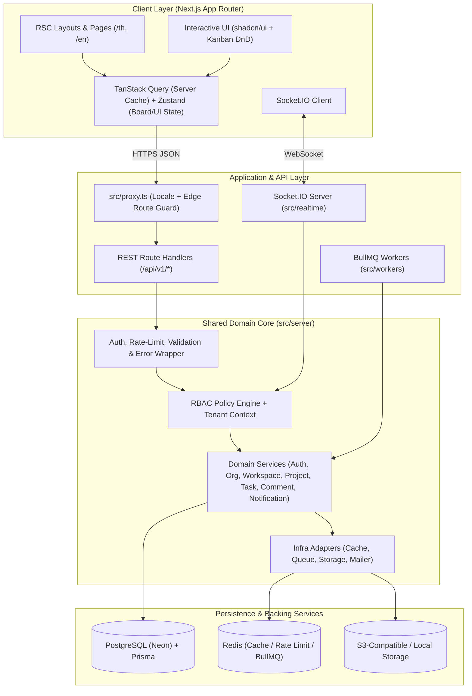

# WorkSphere — System Architecture & Engineering Standards (`WS-005`)

เอกสารนี้อธิบายสถาปัตยกรรมของ **WorkSphere** บนฐาน **Next.js (TypeScript)** ที่รวมทั้ง Web Application, Modular REST Backend, Realtime Socket.IO Server และ BullMQ Background Workers ไว้ใน Repository เดียวโดยแยกชั้นความรับผิดชอบอย่างชัดเจน

---

## 1. High-Level System Architecture



### เหตุผลในการเลือกสถาปัตยกรรมนี้ (Architectural Trade-offs)
1. **Single TypeScript Codebase, Multi-Process Ready**: แชร์ Zod schemas, Prisma types, Auth verifier และ RBAC policies ชุดเดียวกัน 100% ระหว่าง REST API, หน้าเว็บ RSC, Socket.IO และ BullMQ Workers โดยไม่ต้องคัดลอก DTO ข้ามโปรเจกต์
2. **Strict Layered Boundaries (เทียบเท่าโมดูลของ NestJS)**:
   - **Route Handlers (`app/api/v1/...`)** ทำหน้าที่เฉพาะรับ HTTP Request, แปลงพารามิเตอร์, เรียกใช้ Service และส่ง HTTP Response — **ห้ามเขียน Business Logic หรือเรียก `db` (Prisma) โดยตรง**
   - **Domain Services (`src/server/modules/*`)** ตรวจสิทธิ์ผ่าน Policy, จัดการ Transaction, ตรวจจับ Cycle/Version conflict และส่ง Event เข้า Queue/Realtime
   - **Infrastructure Adapters (`src/server/infra/*`)** หุ้ม Redis, Storage และ Mailer ด้วย Interface เพื่อให้รันทดสอบในเครื่องหรือบน CI ได้แม้ไม่ได้ต่อคลาวด์ภายนอกครบทุกตัว

---

## 2. โครงสร้างโฟลเดอร์มาตรฐาน (Repository Structure)

```text
worksphere/
├── docs/                          # เอกสารออกแบบระบบ (Phase 0–8)
├── messages/                      # ไฟล์ภาษา th.json, en.json
├── prisma/
│   ├── schema.prisma              # โครงสร้างฐานข้อมูลหลัก
│   ├── migrations/                # ประวัติการแก้ไขตาราง
│   └── seed.ts                    # ข้อมูลตัวอย่างและบัญชี Demo
├── src/
│   ├── app/
│   │   ├── [locale]/              # หน้าเว็บทั้งหมด (Auth, Dashboard, Org, Project, Board)
│   │   └── api/v1/                # REST API Endpoints ทั้งหมด
│   ├── components/                # UI Components (ui/, board/, tasks/, layout/)
│   ├── hooks/                     # Custom React Hooks (TanStack Query, Socket.IO)
│   ├── stores/                    # Zustand Stores (board filter, modal, active tenant)
│   ├── i18n/                      # ตั้งค่า next-intl
│   ├── lib/
│   │   ├── validation/            # Shared Zod Schemas (ใช้ร่วมกันทั้งฟอร์มและ API)
│   │   └── ordering/              # Fractional Indexing algorithm
│   ├── server/
│   │   ├── db.ts                  # Singleton Prisma Client
│   │   ├── http/                  # Error classes, Route wrapper, Pagination helpers
│   │   ├── permissions/           # RBAC Matrix & Guard assertions
│   │   ├── infra/                 # Redis, Cache, RateLimiter, Storage, Mailer, Logger
│   │   └── modules/               # แยกตามโดเมนธุรกิจ
│   │       ├── auth/
│   │       ├── organization/
│   │       ├── workspace/
│   │       ├── project/
│   │       ├── task/
│   │       ├── comment/
│   │       ├── notification/
│   │       └── analytics/
│   ├── realtime/                  # Socket.IO server entrypoint & room handlers
│   └── workers/                   # BullMQ queue definitions & worker processors
└── tests/
    ├── integration/               # API + Database integration tests
    ├── security/                  # Cross-tenant & RBAC matrix tests
    ├── e2e/                       # Playwright browser tests
    └── load/                      # Load test scripts
```

---

## 3. การออกแบบกลไกเชิงลึก (Deep-Dive Technical Designs)

### 3.1 Tenant Isolation & RBAC Pipeline
ทุก Request ที่เข้าสู่ข้อมูลระดับองค์กรต้องไหลผ่านลำดับนี้เสมอ:
1. **Authenticate**: ตรวจสอบ Access Token / Session Cookie → ได้ `actorUserId`
2. **Resolve Tenant Context**: อ่าน `orgId` จาก Path หรือจากทรัพยากรเป้าหมาย แล้วดึง `OrganizationMember` ของ `(orgId, actorUserId)`
   - หากไม่เป็นสมาชิกขององค์กรนั้น → ตอบ `404 Not Found` (ซ่อนการมีอยู่ของทรัพยากรต่างองค์กร)
3. **Authorize Action**: คำนวณสิทธิ์จริง (`effectiveRole`) จากระดับ Org + Workspace + Project แล้วเรียก `assertPermission(...)`
4. **Scoped Query**: ทุกคำสั่ง Prisma ต้องระบุ `where: { id, orgId: ctx.orgId, deletedAt: null }` เสมอ

### 3.2 Concurrency Control (Optimistic Locking)
สำหรับการแก้ไข `Task` หรือการย้ายการ์ดที่มีโอกาสชนกันสูง:
```ts
const updated = await tx.task.updateMany({
  where: { id: taskId, orgId: ctx.orgId, version: input.version, deletedAt: null },
  data: { ...patch, version: { increment: 1 } },
});
if (updated.count === 0) throw conflict("VERSION_CONFLICT", latestTask);
```

### 3.3 Task Dependency Cycle Detection
เมื่อผู้ใช้ขอเพิ่มความสัมพันธ์ `taskId` ต้องรอ `dependsOnTaskId`:
1. ตรวจว่าทั้งสองใบอยู่ใน `projectId` เดียวกันและไม่ใช่ใบเดียวกัน
2. เปิด Transaction โหลดรายการ `(taskId, dependsOnTaskId)` ทั้งหมดของโปรเจกต์นั้น
3. รัน **Depth-First Search (DFS)** จาก `dependsOnTaskId` ไปตามทิศทางสิ่งที่มันรอ หากเดินไปเจอ `taskId` แปลว่าจะเกิดวงจรปิด → ปฏิเสธด้วย `409 DEPENDENCY_CYCLE`

### 3.4 Redis Caching & Invalidation Strategy
| ข้อมูลที่ Cache | รูปแบบ Key | TTL | เงื่อนไขการล้างค่า (Invalidation) |
|---|---|---|---|
| สมาชิกและสิทธิ์ในองค์กร | `org:{orgId}:member:{userId}` | 5 นาที | เมื่อเปลี่ยน Role, ลบสมาชิก หรือยอมรับคำเชิญ |
| โครงสร้างโปรเจกต์ & คอลัมน์ | `proj:{projectId}:meta` | 10 นาที | เมื่อแก้ชื่อโปรเจกต์, Archive หรือแก้ไขคอลัมน์ |
| สรุปตัวเลข Dashboard | `org:{orgId}:dashboard` / `proj:{projectId}:stats` | 2 นาที | เมื่อสร้าง/ลบ Task หรือเปลี่ยนหมวดสถานะงาน |

### 3.5 BullMQ Background Jobs & Reliability
- **Queues**: `mail` (คำเชิญ, ยืนยันอีเมล, รีเซ็ตรหัสผ่าน), `reminders` (เตือนงานใกล้ครบกำหนด), `exports` (สร้างไฟล์ CSV/JSON), `digests` (สรุปรายสัปดาห์)
- **Retry Policy**: `attempts: 4`, `backoff: { type: "exponential", delay: 2000 }`
- **Idempotency**: กำหนด `jobId` แบบตายตัวตามเหตุการณ์ (เช่น `invite-email:${invitationId}`, `due-reminder:${taskId}:${yyyyMmDd}`) เพื่อไม่ให้ส่งซ้ำแม้เกิดการ enqueue ซ้ำ

### 3.6 Realtime Authorization (Socket.IO)
- ตอนเชื่อมต่อ (`connection`): ตรวจสอบ Cookie / Auth Token จาก handshake หากไม่ผ่านให้ตัดการเชื่อมต่อทันที (`401`)
- ตอนขอเข้าห้อง (`room:join` สำหรับ `project:{projectId}`): เรียก `canReadProject(userId, projectId)` ที่ฝั่ง Server ก่อนสั่ง `socket.join(...)` เสมอ

---

## 4. มาตรฐานการพัฒนา (Engineering Conventions)

### 4.1 Naming Conventions
- **ไฟล์และโฟลเดอร์**: `kebab-case.ts` (เช่น `task-dependency.service.ts`, `kanban-column.tsx`)
- **Database Models / Types**: `PascalCase` สำหรับชื่อตาราง/โมเดล (`BoardColumn`) และ `camelCase` สำหรับชื่อฟิลด์ (`dependsOnTaskId`)
- **REST Endpoints**: ใช้คำนามพหูพจน์ `kebab-case` ภายใต้ `/api/v1/` (เช่น `/api/v1/organizations/:orgId/audit-logs`)
- **Realtime & Activity Events**: `domain.past_tense` เช่น `task.created`, `task.moved`, `comment.added`

### 4.2 Git Branching & Commit Strategy
- Branch หลัก: `main` (พร้อมใช้งานเสมอ ผ่าน lint/typecheck/test/build)
- Feature branch ต่อหนึ่งงาน: `feat/WS-201-auth-session`, `fix/WS-404-cycle-check`
- รูปแบบ Commit (Conventional Commits): `feat(WS-201): implement argon2 registration and token rotation`

### 4.3 Definition of Done (DoD) ประจำแต่ละ Task และทั้งโปรเจกต์
1. โค้ดผ่าน `npm run typecheck` และ `npm run lint` แบบไม่มี error
2. มีการตรวจ Input ด้วย Zod และตรวจสิทธิ์ RBAC + `orgId` ที่ฝั่ง Backend ครบทุกจุด
3. มี Automated Tests (Unit / Integration / E2E ตามประเภทงาน) ครอบคลุมทั้งกรณีสำเร็จและกรณีไม่มีสิทธิ์/ข้อมูลผิดพลาด
4. อัปเดตไฟล์แปลภาษาทั้ง `messages/th.json` และ `messages/en.json` หากมีข้อความบนหน้าเว็บ
5. อัปเดตเอกสารและสถานะงานใน `docs/backlog.md` เรียบร้อย
