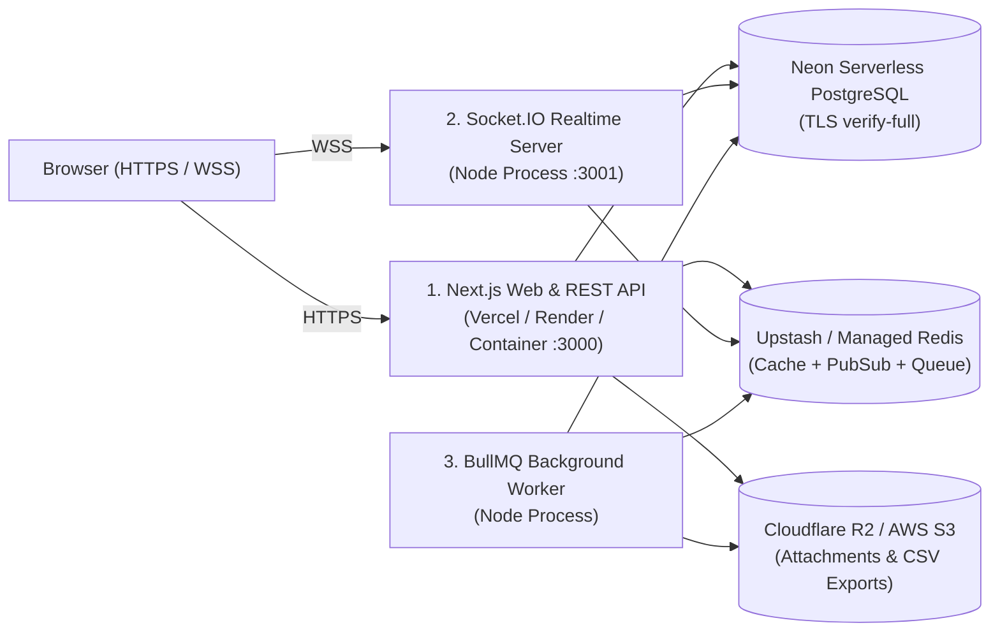

# WorkSphere — Production Deployment, Security & Operations Guide (`WS-802`)

เอกสารนี้อธิบายสถาปัตยกรรมการนำระบบ **WorkSphere** ขึ้นใช้งานจริงบน Production การจัดการตัวแปรความลับ (Secrets) การอัปเดตฐานข้อมูลโดยไม่กระทบผู้ใช้งาน (Zero-downtime Migration) และแผนการสำรอง/กู้คืนข้อมูล (Backup & Disaster Recovery)

---

## 1. สถาปัตยกรรม Production Topology

WorkSphere ใช้โค้ดเบสเดียว (Monorepo-in-one-app) ที่รันแยกเป็น 3 โปรเซสตามหน้าที่ เพื่อให้ขยายขนาด (Scale) แยกกันได้อย่างอิสระ:



| บริการ | คำสั่งรัน Production | แพลตฟอร์มแนะนำ |
|---|---|---|
| **Web + REST API** | `npm run build && npm run start` | Vercel / Render / Railway / Fly.io / Docker |
| **Realtime Server** | `npx tsx src/realtime/server.ts` | Render / Railway / Fly.io (เปิด WebSocket Sticky/Redis Adapter) |
| **Background Worker** | `npx tsx src/workers/index.ts` | Render Background Worker / Railway / Docker |
| **PostgreSQL** | Managed PostgreSQL 16+ | Neon Serverless Postgres / Supabase / AWS RDS |
| **Redis** | Managed Redis 7+ (TLS `rediss://`) | Upstash Redis / Render Key Value |

---

## 2. Production Secrets & HTTPS Hardening Checklist

ตั้งค่า Environment Variables ต่อไปนี้ใน Secret Manager ของผู้ให้บริการคลาวด์ (**ห้ามเก็บใน Git เด็ดขาด**):

| ตัวแปร | ข้อกำหนดระดับ Production |
|---|---|
| `NODE_ENV` | ตั้งเป็น `"production"` เสมอ เพื่อเปิดใช้งานคุกกี้ `Secure` อัตโนมัติ |
| `APP_URL` | โดเมน HTTPS จริง เช่น `https://worksphere.example.com` (ใช้ตรวจ `Origin` สกัด CSRF) |
| `NEXT_PUBLIC_REALTIME_URL` | โดเมน WSS ของ Socket.IO เช่น `https://realtime.worksphere.example.com` |
| `AUTH_SECRET` | สุ่มความยาวอย่างน้อย 64 ตัวอักษรด้วย `openssl rand -base64 48` |
| `DATABASE_URL` | Connection String ของ PostgreSQL ที่บังคับ `sslmode=verify-full` |
| `REDIS_URL` | `rediss://default:<password>@<host>:<port>` สำหรับแชร์ Cache, Rate Limit และ BullMQ |
| `STORAGE_DRIVER` | `"s3"` สำหรับ Production (พร้อม `S3_ENDPOINT`, `S3_BUCKET`, `S3_ACCESS_KEY_ID`, `S3_SECRET_ACCESS_KEY`) |
| `MAIL_DRIVER` | `"smtp"` สำหรับส่งอีเมลยืนยันบัญชี คำเชิญองค์กร และแจ้งเตือนกำหนดส่งงาน |

---

## 3. ขั้นตอน Database Migration บน Production

1. **ห้ามใช้ `prisma migrate dev` บนฐานข้อมูล Production** — ให้ใช้คำสั่งต่อไปนี้ในขั้นตอน Release / CI เสมอ:
   ```bash
   npx prisma migrate deploy
   ```
2. **แนวทาง Expand-and-Contract เพื่อลด Downtime**:
   - เมื่อต้องเปลี่ยนโครงสร้างตาราง ให้เพิ่มคอลัมน์ใหม่แบบ Optional (`NULL` หรือมี `DEFAULT`) ก่อนใน Release แรก
   - อัปเดตโค้ดให้อ่าน/เขียนรองรับทั้งโครงสร้างเก่าและใหม่
   - ค่อยลบคอลัมน์เก่าใน Release ถัดไปหลังจากตรวจสอบว่าไม่มีโค้ดส่วนใดเรียกใช้แล้ว
3. **การเติมข้อมูลบัญชีตัวอย่างสำหรับโหมด Portfolio Demo**:
   ```bash
   npm run db:seed
   ```
   สคริปต์ `prisma/seed.ts` ออกแบบด้วย `upsert` แบบ Idempotent รันซ้ำกี่ครั้งก็ไม่ลบหรือกระทบองค์กรของผู้ใช้งานจริง

---

## 4. แผนการสำรองข้อมูลและการกู้คืน (Backup, PITR & Monitoring)

- **Point-in-Time Recovery (PITR)**: เปิดใช้งาน History Retention บน Neon PostgreSQL (7–30 วัน) เพื่อให้ย้อนเวลาฐานข้อมูลกลับไปยังวินาทีก่อนเกิดเหตุขัดข้องได้ทันที (**RPO < 1 นาที, RTO < 15 นาที**)
- **Logical Nightly Snapshot**: ตั้ง Cron สำรองไฟล์ Logical Dump แยกเก็บลง Object Storage:
  ```bash
  pg_dump "$DATABASE_URL" --format=custom --no-owner --file="backup-$(date +%F).dump"
  ```
- **Uptime & Deep Health Check**: ตั้ง Uptime Monitor ยิงตรวจ `GET /api/v1/health?deep=1` ทุก 60 วินาที:
  - คืน `200 OK` เมื่อ Application, PostgreSQL (`SELECT 1`), Redis (`PING`) และ Storage พร้อมใช้งาน
  - คืน `503 Service Unavailable` ทันทีหากฐานข้อมูลหลักขัดข้อง เพื่อให้ระบบแจ้งเตือนทีมดูแลได้ทันท่วงที
