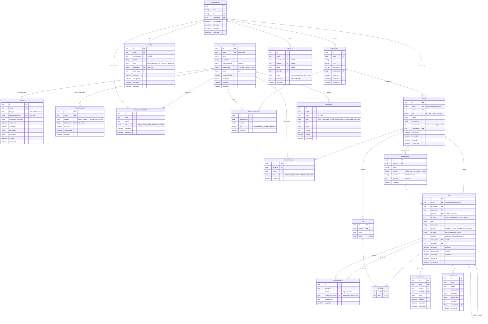

# WorkSphere — Entity-Relationship Diagram & Data Dictionary (`WS-004`)

ออกแบบสำหรับ **PostgreSQL + Prisma** โดยรองรับ Multi-tenancy เต็มรูปแบบ (`Organization` → `Workspace` → `Project` → `Task` / `Subtask`), ระบบ Refresh Token Rotation, Task Dependency Graph, Optimistic Locking (`version`) และ Audit/Notification

## 1. ER Diagram

---

## 2. เหตุผลเชิงวิศวกรรมของโครงสร้างข้อมูล (Key Design Decisions)

1. **Denormalized `orgId` เพื่อป้องกันข้อมูลรั่วข้ามองค์กร**
   - ตาราง `Workspace`, `Project`, `Task`, `Comment`, `Attachment`, `ActivityLog` และ `Notification` เก็บ `orgId` ไว้โดยตรง ทำให้ทุก Query สามารถใส่เงื่อนไข `WHERE orgId = ctx.orgId` ได้ทันทีโดยไม่ต้อง `JOIN` ย้อนหลายชั้น และสร้าง Composite Index ที่มี `orgId` นำหน้าได้
2. **Refresh Token Family (`Session.familyId` + `replacedByTokenHash`)**
   - ทุกครั้งที่ขอ Refresh Token ใหม่ แถวเดิมจะถูกบันทึก `replacedByTokenHash` และสร้างแถวใหม่ใน `familyId` เดียวกัน หากผู้โจมตีขโมย Token เก่ามาใช้ซ้ำ ระบบจะเห็นว่าแถวนั้นถูกหมุนไปแล้ว และสั่ง `revokedAt = now()` ทั้ง `familyId` ทันที
3. **เลขรหัสงานแบบ Jira (`Project.taskCounter` + `Task.number`)**
   - เมื่อสร้าง Task ใหม่ ระบบสั่ง `UPDATE Project SET taskCounter = taskCounter + 1 RETURNING taskCounter` ภายใน Transaction เดียวกับการ `INSERT Task` จึงรับประกันว่าเลข `WS-1`, `WS-2` ไม่ชนกันแม้ยิงพร้อมกันหลายคำขอ
4. **Fractional Indexing (`BoardColumn.position`, `Task.position`)**
   - เก็บลำดับเป็น lexicographical string (เช่น `"a0"`, `"a0V"`, `"a1"`) เมื่อลากการ์ดแทรกระหว่างสองใบ จะคำนวณค่ากลางและ `UPDATE` แค่แถวเดียว ไม่ต้องรันเลขใหม่ทั้งคอลัมน์
5. **Optimistic Locking (`Task.version`)**
   - ทุกการอัปเดตสำคัญใช้เงื่อนไข `WHERE id = :id AND version = :expectedVersion` พร้อมเพิ่ม `version = version + 1` หากจำนวนแถวที่อัปเดตเป็น `0` ระบบรู้ทันทีว่าเกิดการแก้ไขชนกันและตอบ `409 Conflict`
6. **Task Dependency Graph (`TaskDependency`)**
   - บังคับ Unique `(taskId, dependsOnTaskId)` และ `CHECK (taskId <> dependsOnTaskId)` พร้อมตรวจจับ Cycle ในระดับ Service ภายใน Transaction ด้วยการดึงกราฟของ `projectId` เดียวกันมาวิ่ง DFS ก่อนบันทึก

---

## 3. แผนการทำ Indexes หลัก (Database Indexing Plan)

| ตาราง | Index / Unique Constraint | จุดประสงค์ |
|---|---|---|
| `OrganizationMember` | `UNIQUE(orgId, userId)`, `INDEX(userId)` | ตรวจสิทธิ์เข้าองค์กรและดึงรายชื่อองค์กรของผู้ใช้ |
| `Workspace` | `UNIQUE(orgId, slug)`, `INDEX(orgId)` | ค้นหา Workspace ตาม URL slug ภายในองค์กร |
| `Project` | `UNIQUE(orgId, key)`, `INDEX(workspaceId, archivedAt)` | ค้นหาโปรเจกต์ตามรหัสย่อและแสดงรายการใน Workspace |
| `Task` | `UNIQUE(projectId, number)` | ค้นหางานด้วยรหัสเช่น `WS-42` |
| `Task` | `INDEX(columnId, deletedAt, position)` | โหลดกระดาน Kanban เรียงตามลำดับในแต่ละคอลัมน์ |
| `Task` | `INDEX(projectId, deletedAt, status/priority/assigneeId, createdAt)` | รองรับ Filter & Cursor Pagination ในหน้ารายการงาน |
| `TaskDependency` | `UNIQUE(taskId, dependsOnTaskId)`, `INDEX(projectId)`, `INDEX(dependsOnTaskId)` | โหลดกราฟตรวจ Cycle และเช็กงานที่ถูกบล็อก |
| `ActivityLog` | `INDEX(projectId, createdAt DESC)`, `INDEX(orgId, createdAt DESC)` | เปิดดูประวัติกิจกรรมแบบแบ่งหน้าอย่างรวดเร็ว |
| `Notification` | `INDEX(userId, readAt, createdAt DESC)` | นับจำนวนแจ้งเตือนที่ยังไม่อ่านและดึงรายการล่าสุด |
