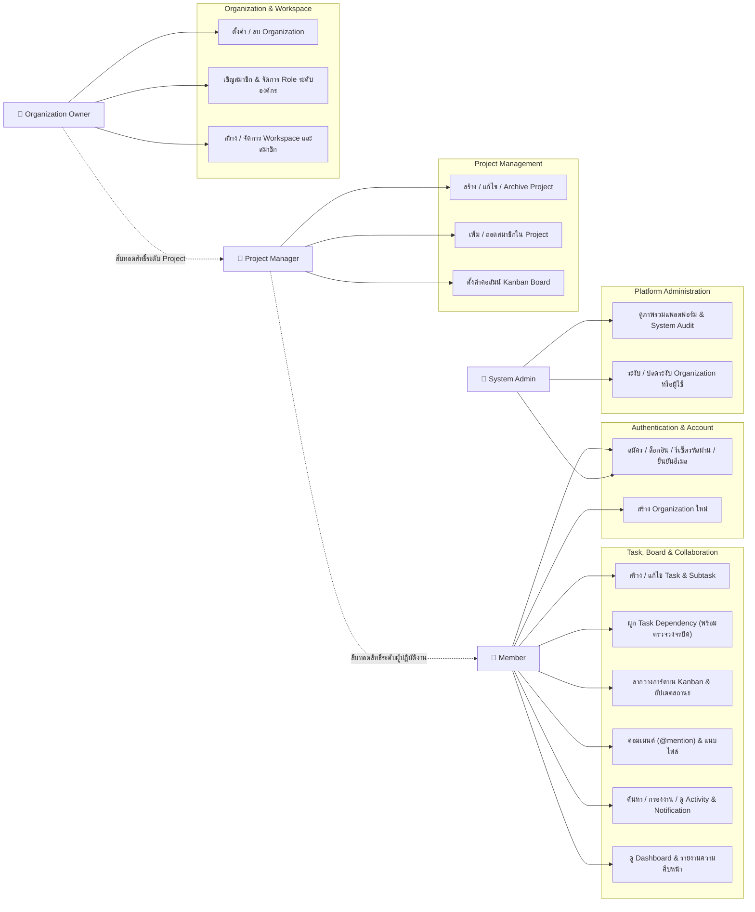
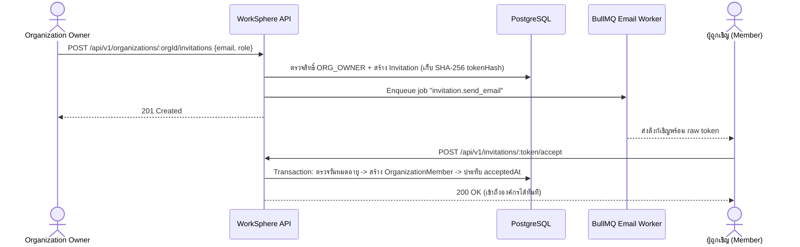
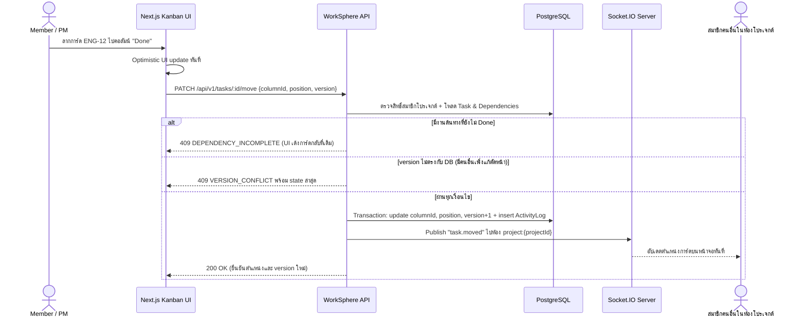

# WorkSphere — Use Case Diagrams & Scenarios (`WS-003`)

เอกสารนี้แสดงความสัมพันธ์ระหว่างผู้ใช้งานทั้ง 4 บทบาท (`System Admin`, `Organization Owner`, `Project Manager`, `Member`) กับฟีเจอร์หลักของระบบ WorkSphere

## 1. ภาพรวม Use Case ตามบทบาท (Actor-Goal Diagram)

---

## 2. ลำดับการทำงานของ Use Case สำคัญ (Key Flows)

### UC-01: เชิญสมาชิกเข้าองค์กรและยอมรับคำเชิญ (Invitation Lifecycle)

### UC-02: ย้ายการ์ดบน Kanban พร้อมตรวจ Dependency & Optimistic Locking

